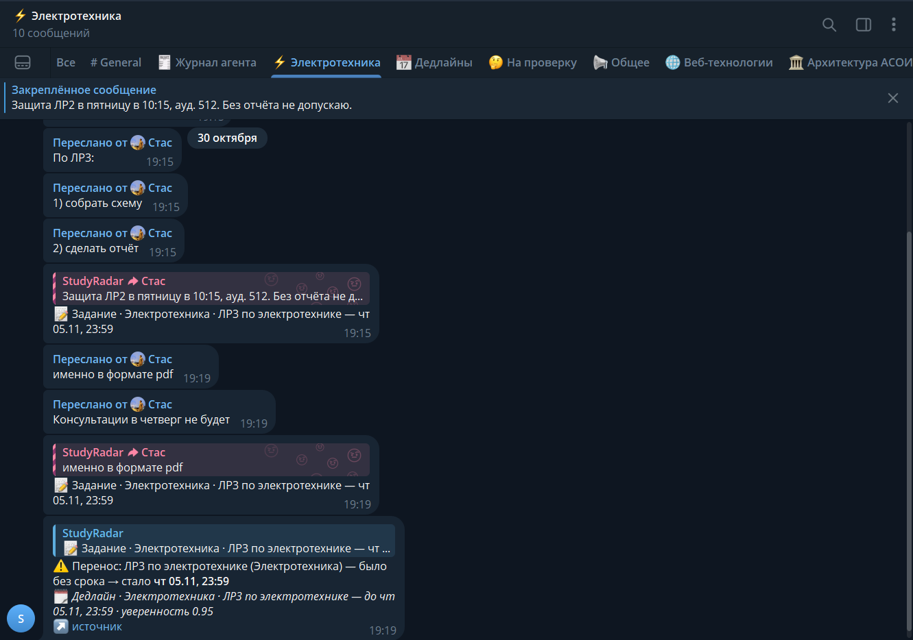
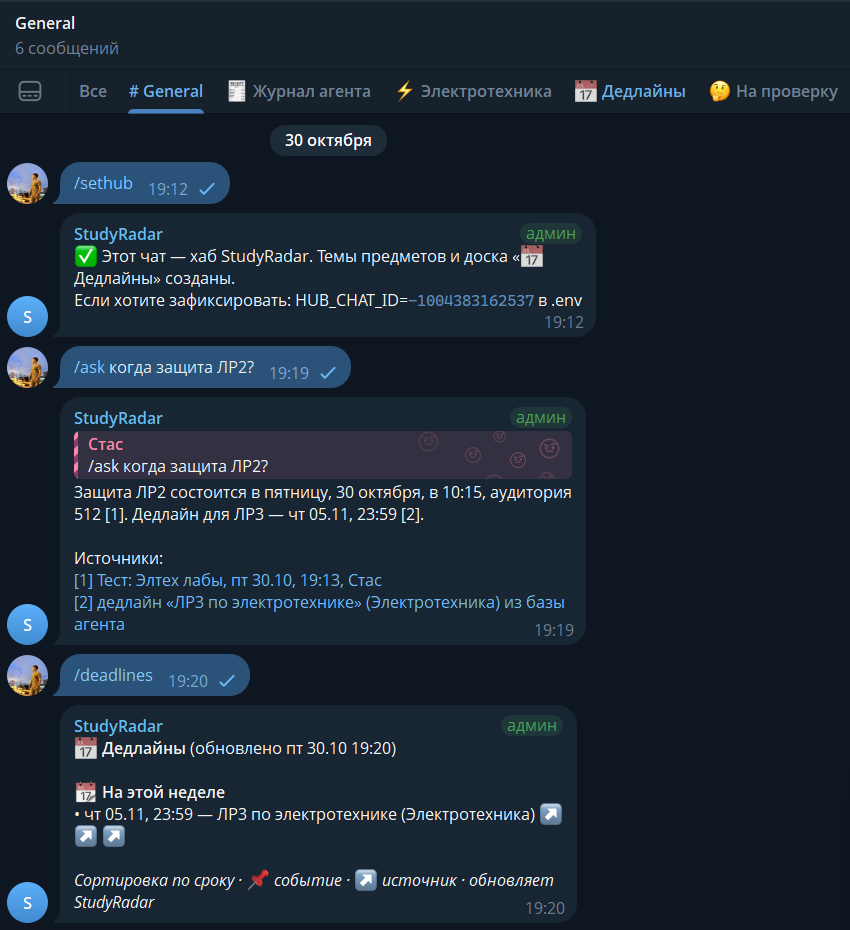
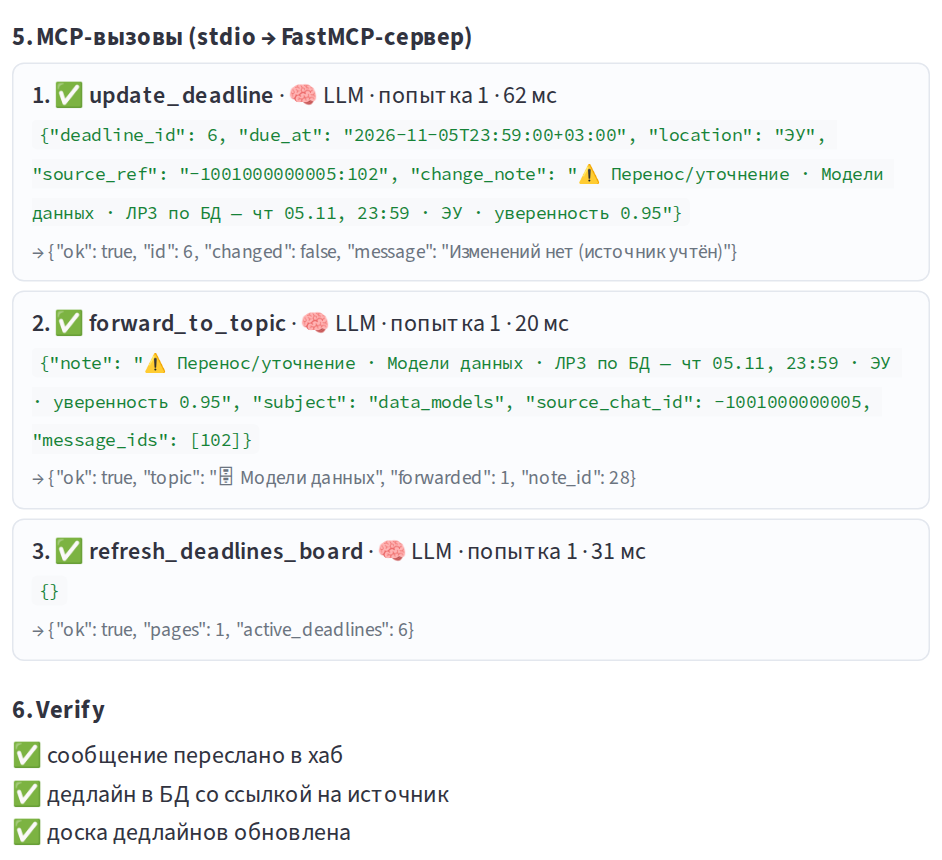
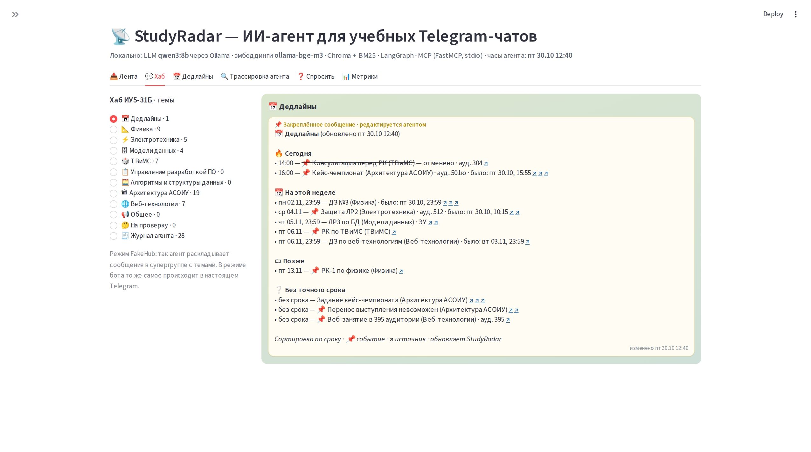
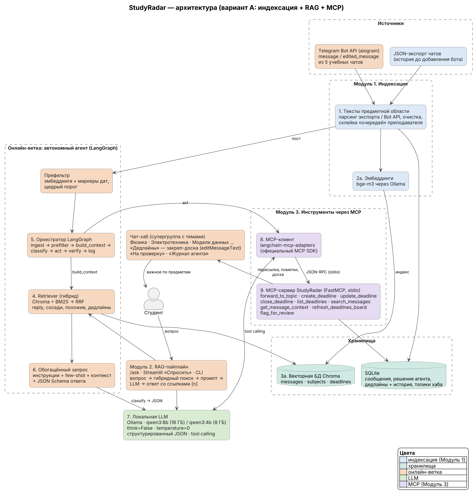

# 📡 StudyRadar — ИИ-агент для учебных Telegram-чатов

**StudyRadar** читает учебные чаты и **по смыслу** решает, что важно: использует локальную LLM, а не ключевые слова. Важное раскладывает по темам-предметам чата-хаба, ведёт **закреплённую доску дедлайнов** (сортировка по сроку) и **сам обновляет** её при переносах, отменах и редактированиях. Отвечает на вопросы по переписке со ссылками на сообщения (`/ask когда сдавать лабу по элтеху?`).

Команда **SuperPuper** · МГТУ им. Н. Э. Баумана, ИУ5-31Б · кейс-чемпионат по созданию ИИ-агентов («Архитектура АСОИУ»).

| «физика — это боль» | «лабу перенесли на среду» (ответом на сообщение о ЛР2) |
|---|---|
| ключевые слова: «физика» → важно ❌ | ключевые слова: предмет не найден ❌ |
| **StudyRadar: шум** ✅ | **StudyRadar: перенос защиты ЛР2 по электротехнике → ср 04.11, дедлайн обновлён, а не продублирован** ✅ |

Всё работает **локально** на ноутбуке: Ollama (`qwen3:8b` или `qwen3:4b` + `bge-m3`), без облачных LLM.

📊 **Презентация:** [`docs/StudyRadar_presentation.pptx`](docs/StudyRadar_presentation.pptx) (PDF: [`docs/StudyRadar_presentation.pdf`](docs/StudyRadar_presentation.pdf)).

---

## 👀 Как это выглядит

**В Telegram** (`make bot`, модель `qwen3:8b` на ноутбуке команды):

| Тема предмета в чате-хабе | Доска дедлайнов, `/ask` и `/deadlines` |
|---|---|
|  |  |

Важное пересылается в тему своего предмета с пометкой агента: категория, предмет, срок. При изменении срока бот отвечает «⚠️ Перенос: было → стало». Доска дедлайнов — одно закреплённое сообщение, которое бот редактирует.

**В интерфейсе Streamlit** (`make simulate` → `make ui`):

| Трассировка агента: LLM вызывает MCP-инструменты | Хаб и доска дедлайнов |
|---|---|
|  |  |

Все кадры — в [`docs/screenshots/`](docs/screenshots/).

---

## 📈 Результаты

`make eval` на размеченных постах из 5 синтетических чатов. Модель `qwen3:8b`, ноутбук: i7-13620H, RTX 4060 Laptop 8 ГБ, WSL2. Полный отчёт — [`docs/eval_report.md`](docs/eval_report.md).

| Метрика | StudyRadar (LLM) | Поиск по ключевым словам |
|---|---|---|
| F1 важности | **0.77** | 0.73 |
| Precision / Recall | **0.62 / 1.00** | 0.62 / 0.87 |
| Точность предмета | **0.96** | 0.43 |
| Точность категории | **0.87** | 0.74 |
| Точность даты (день) | **1.00** | 0.89 |

MCP-действия без фолбэка — 100%, корректных вызовов инструментов от LLM — 94%. Средняя задержка — **5.5 с** на сообщение (на видеокарте).

> **Тестовые заглушки.** Для автотестов без Ollama и Telegram в коде есть `FakeLLM`, `HashEmbedder` и `FakeHub`: это детерминированные правила, а не модель. Все метрики и скриншоты выше получены **с настоящей моделью** через Ollama. Скрипты скриншотов и слайдов не принимают данные заглушек.

---

## 🚀 Как запустить демо за 10 минут

Что понадобится: ноутбук с 16 ГБ RAM (или 8 ГБ — тогда модель `qwen3:4b`), около 8 ГБ свободного места, интернет на время установки. Видеокарта NVIDIA не обязательна, но с ней всё в десятки раз быстрее.

### Вариант 1 — Windows + WSL2 (Ubuntu), рекомендуется

```bash
# 0) один раз, в PowerShell от администратора:  wsl --install -d Ubuntu   (перезагрузка)
# дальше всё — в терминале Ubuntu (WSL)
sudo apt update && sudo apt install -y python3-venv python3-pip make git curl
# если интернет идёт через VPN-прокси: sudo -E apt update ...  (-E передаёт прокси в sudo)

# 1) Ollama и модели (~5.5 ГБ)
curl -fsSL https://ollama.com/install.sh | sh
ollama serve > /tmp/ollama.log 2>&1 &      # если Ollama не запустилась сама как сервис
ollama pull qwen3:8b                        # для 8 ГБ RAM: ollama pull qwen3:4b
ollama pull bge-m3

# 2) проект
git clone https://github.com/winlast/TG_Agent_champ.git && cd TG_Agent_champ
make setup                                  # venv + зависимости (3–5 минут)
# если make setup пишет «Нужен Python 3.11+» (Ubuntu 22.04):
#   curl -LsSf https://astral.sh/uv/install.sh | sh && source ~/.bashrc && make setup
make doctor                                 # чек-лист: всё зелёное → можно запускать

# 3) демо без Telegram
make simulate                               # 36 сообщений из 5 чатов через весь агент
make ui                                     # открыть http://localhost:8501 в браузере Windows
```

Для 8 ГБ RAM впишите в `.env` одну строку `LLM_MODEL=qwen3:4b` (и выполните `ollama pull qwen3:4b`).

**Видеокарта в WSL.** Проверка: `ollama ps` во время работы модели должна показывать `100% GPU`. Если там `100% CPU` — обновите драйвер NVIDIA для Windows (NVIDIA App или nvidia.com), затем в PowerShell выполните `wsl --shutdown` и откройте Ubuntu заново. У нас Ollama увидела видеокарту после обновления драйвера с 536.52 до 621.01.

### Вариант 2 — нативный Windows (без WSL)

1. Установите **Ollama for Windows**: https://ollama.com/download — она запустится сама (значок в трее). В PowerShell: `ollama pull qwen3:8b` и `ollama pull bge-m3`.
2. Установите **Python 3.12** с https://www.python.org/downloads/ (галочка «Add python.exe to PATH»).
3. Скачайте проект: на GitHub зелёная кнопка **Code → Download ZIP**, затем распакуйте (или `git clone`).
4. В PowerShell в папке проекта:

```powershell
powershell -ExecutionPolicy Bypass -File scripts\win.ps1 setup
powershell -ExecutionPolicy Bypass -File scripts\win.ps1 doctor
powershell -ExecutionPolicy Bypass -File scripts\win.ps1 simulate
powershell -ExecutionPolicy Bypass -File scripts\win.ps1 ui
```

### macOS / Linux

То же, что в варианте 1 (Ollama для macOS — https://ollama.com/download), затем `make setup && make doctor && make simulate && make ui`.

### Сколько это работает

| Железо | `qwen3:8b`, на одно важное сообщение | `make simulate` (36 сообщений) |
|---|---|---|
| NVIDIA RTX 4060 Laptop (наш замер) | **~5 с** (~35 токенов/с) | ~10 мин |
| Только CPU | 0,5–2,5 мин (`qwen3:4b` — примерно вдвое быстрее) | 10–40 мин |

Шум, отсеянный префильтром, обрабатывается мгновенно. Точную скорость на вашем ноутбуке покажет `make doctor-deep`. На CPU запускайте `make simulate` заранее; прогресс виден в терминале и в интерфейсе. Ускорение на CPU: `make simulate-fast` (`qwen3:4b`) или `export OLLAMA_NUM_PARALLEL=2` перед `ollama serve`.

---

## 🖥 Интерфейс (make ui → http://localhost:8501)

| Вкладка | Что показывает |
|---|---|
| 📥 Лента | все входящие сообщения и решение агента: категория, предмет, уверенность, причина; цвет — важное / шум / на проверку |
| 💬 Хаб | «как в Telegram»: темы предметов, пересланные сообщения с пометками агента, закреплённая доска дедлайнов |
| 📅 Дедлайны | таблица по сроку + история изменений (было → стало, по какому сообщению) |
| 🔍 Трассировка агента | RAG-контекст → промпт → JSON-классификация → **последовательность MCP-вызовов** с аргументами и результатами → verify |
| ❓ Спросить | RAG-ответы со ссылками на исходные сообщения |
| 📊 Метрики | результаты `make eval` и сравнение с поиском по ключевым словам |

Кнопка «▶ Проиграть сценарий» в боковой панели запускает `simulate` прямо из интерфейса и обновляет экраны по ходу.

---

## 🤖 Режим Telegram-бота

Бот читает чаты-источники (новые и **отредактированные** сообщения) и ведёт **чат-хаб** — супергруппу с темами.

1. **Создать бота.** Telegram → @BotFather → `/newbot` → имя → получите токен вида `123456:ABC...`. Впишите его в `.env`: `TELEGRAM_BOT_TOKEN=...`
2. **Выключить privacy mode** (иначе бот не видит обычные сообщения в группах): @BotFather → `/setprivacy` → выберите бота → **Disable**. Если бот уже был в группах — удалите его оттуда и добавьте заново.
3. **Создать хаб.** Telegram → «Новая группа» (например «StudyRadar Хаб») → в настройках группы включите **Темы (Topics)**. Добавьте бота и сделайте его **администратором** с правами «Управление темами» и «Закрепление сообщений».
4. **Добавить бота в учебные чаты-источники** (обычным участником; если privacy mode не выключали — админом).
5. **Если Telegram открывается только через VPN** (в WSL это обычная ситуация): впишите в `.env` адрес прокси вашего VPN-клиента, например `TELEGRAM_PROXY=http://127.0.0.1:7897`. Порт смотрите в настройках VPN-клиента. Если переменная `https_proxy` уже задана в системе, бот возьмёт её сам.
6. Запустить: `make bot`. В группе-хабе написать **`/sethub`** — бот сам создаст темы (📅 Дедлайны, предметы, 🤔 На проверку, 🧾 Журнал агента) и закрепит доску.
7. Проверка: `make doctor` покажет, отвечает ли бот (и через какой прокси), видит ли он хаб, есть ли права и выключен ли privacy mode.

Команды бота: `/deadlines` — доска дедлайнов, `/ask вопрос` — ответ по переписке со ссылками, `/chatid` — id чата, `/sethub` — сделать чат хабом.

Бот обрабатывает сообщение примерно через минуту: сначала ждёт 45 секунд, не продолжит ли автор мысль следующим сообщением, затем думает модель. Сценарий для проверки и съёмки скриншотов — [`docs/demo_script.md`](docs/demo_script.md).

**Как узнать chat id:** напишите в чате `/chatid` — бот ответит. Для `.env`: `HUB_CHAT_ID=-100…` (необязательно, если сделали `/sethub`), `SOURCE_CHAT_IDS=-100…,-100…` (пусто = все чаты, где есть бот).

**История до добавления бота.** Бот не видит старые сообщения, поэтому их загружают из экспорта: Telegram Desktop → чат → ⋮ → **Экспорт истории чата** → снять галочки с фото и видео → формат **JSON** → `result.json`. Положите файл в `data/private/` (эта папка не попадает в git) и выполните:

```bash
make index EXPORT=data/private/result.json
```

---

## 🏛 Архитектура (вариант А)



| Модуль | Где в коде | Что делает |
|---|---|---|
| **1. Индексация** | `src/study_radar/index/`, `src/study_radar/ingest/` | парсер Telegram-экспорта и Bot API, склейка «очередей», эмбеддинги `bge-m3` → Chroma (`messages`, `subjects`, `deadlines`) |
| **2. RAG-пайплайн** | `src/study_radar/retrieval/hybrid.py`, `src/study_radar/agent/ask.py` | гибридный поиск Chroma + BM25 (RRF) → обогащённый промпт `prompts/ask.md` → LLM → ответ со ссылками |
| **3. Инструменты через MCP** | `src/study_radar/mcp_server/server.py`, `src/study_radar/agent/graph.py` (узел `act`) | FastMCP-сервер (stdio, 9 инструментов); LLM **сама** вызывает инструменты (tool calling), фолбэк — через те же MCP-инструменты |

Граф LangGraph: `ingest → prefilter → build_context (RAG) → classify → act (LLM + MCP) → verify → log`.

Инструменты MCP: `forward_to_topic`, `create_deadline`, `update_deadline`, `close_deadline`, `list_deadlines`, `search_messages`, `get_message_context`, `refresh_deadlines_board`, `flag_for_review`. Сервер можно запустить отдельно (например, для MCP Inspector): `python -m study_radar.mcp_server.server`.

Подробнее: [`docs/decisions.md`](docs/decisions.md) (принятые решения), [`docs/devlog.md`](docs/devlog.md) (ход разработки и трудности), `CLAUDE.md` (техническое задание).

---

## 🎤 Презентация для защиты

Готовые файлы: **`docs/StudyRadar_presentation.pptx`** и **`docs/StudyRadar_presentation.pdf`**. Содержимое слайдов продублировано в `docs/presentation.md`. Слайды собираются скриптом `scripts/build_slides.py` из `docs/team.yaml` (состав команды), `docs/screenshots/` (кадры) и `docs/eval_report.json` (метрики):

```bash
make presentation      # simulate (настоящая модель) → автоматические скриншоты интерфейса → слайды
make eval              # метрики качества → docs/eval_report.md (195 постов; make eval-quick — 80 постов)
make slides            # пересобрать слайды после любых изменений
```

`make eval` с видеокартой занимает 10–20 минут, на CPU — 1–3 часа. Кадры из Telegram (`docs/screenshots/tg_*.png`) снимаются вручную по [`docs/demo_script.md`](docs/demo_script.md).

---

## 🧰 Все команды

| make | Windows (`scripts\win.ps1 …`) | Что делает |
|---|---|---|
| `make setup` | `setup` | venv + зависимости, создаёт `.env` |
| `make doctor` | `doctor` | проверка Ollama, моделей, токена, хаба (с подсказками) |
| `make doctor-deep` | — | то же + замер скорости генерации |
| `make simulate` | `simulate` | демо-сценарий `data/scenarios/demo.yaml` настоящей моделью |
| `make simulate-fast` | `simulate-fast` | то же на `qwen3:4b` |
| `make ui` | `ui` | интерфейс Streamlit |
| `make bot` | `bot` | режим Telegram-бота |
| `make index EXPORT=…` | `index путь` | загрузить историю из JSON-экспорта |
| `make ask Q='…'` | `ask "…"` | вопрос по переписке из терминала |
| `make test` | `test` | автотесты (без Ollama и Telegram) |
| `make eval` / `make eval-quick` | `eval` / `eval-quick` | оценка качества + бейзлайн → `docs/eval_report.md` |
| `make presentation` | `presentation` | simulate + скриншоты + слайды |
| `make slides` | `slides` | пересобрать `docs/StudyRadar_presentation.pptx` |

Модель меняется **одной строкой** в `.env`: `LLM_MODEL=qwen3:4b` (или `qwen3:8b`). Остальные настройки — в `config/settings.yaml`, справочник предметов и доверенных авторов — в `config/subjects.yaml`.

---

## 📁 Структура

```
config/            settings.yaml, subjects.yaml (предметы, алиасы, «физра ≠ физика», доверенные авторы)
prompts/           classify.md (правила + 10 few-shot), act.md, ask.md
src/study_radar/
  ingest/          telegram_export.py, normalize.py, bursts.py, bot_listener.py
  index/           embedder.py, vector_store.py, indexer.py            ← Модуль 1
  retrieval/       hybrid.py                                           ← Модуль 2 (поиск)
  agent/           prefilter, context, classify, dates, dedup, graph (LangGraph), ask (RAG), mcp_client
  mcp_server/      server.py (FastMCP), tools.py                       ← Модуль 3
  telegram/        hub.py (BotHub, FakeHub), board.py, notes.py
  llm/             client.py (OllamaLLM, FakeLLM)
  storage/         db.py, migrations.sql (SQLite)
  ui/app.py        Streamlit;   cli.py — Typer;   doctor.py;   eval.py;   simulate.py
data/fixtures/     5 синтетических чатов в формате Telegram-экспорта (214 сообщений, имена вымышлены)
data/scenarios/    demo.yaml — сценарий демо
data/eval/         labeled.jsonl — 195 размеченных постов
data/private/      ваши реальные экспорты (в .gitignore!)
docs/              презентация (.pptx, .pdf, .md), screenshots/, architecture.puml/.png, eval_report.md,
                   demo_script.md, decisions.md, devlog.md, team.yaml
scripts/           make_fixtures.py, screenshots.py, build_slides.py, win.ps1
tests/             pytest: парсер, даты, склейка, MCP (stdio), переносы, дубли, редактирование, фолбэк, RAG, бот
```

**Приватность:** реальные переписки, `.env`, базы и индексы в git не попадают (`.gitignore`).

---

## ❓ Если что-то не работает

| Симптом | Решение |
|---|---|
| `Ollama недоступна` | WSL: `ollama serve &`; Windows: запустить приложение Ollama. Проверка: `curl http://localhost:11434/api/tags` |
| `Не скачаны модели` | `ollama pull qwen3:8b` и `ollama pull bge-m3` (или `qwen3:4b`) |
| Очень медленно, в `ollama ps` — `100% CPU` | обновить драйвер NVIDIA для Windows, затем `wsl --shutdown`; без видеокарты — `LLM_MODEL=qwen3:4b` в `.env` |
| Нехватка памяти, WSL или VS Code отключаются | `qwen3:4b`; в `config/settings.yaml` уменьшить `num_ctx` до 4096; ограничить память WSL в `%UserProfile%\.wslconfig` (`[wsl2]` → `memory=12GB`) |
| `make doctor`: Telegram — `ClientConnectorError` или таймаут | Telegram доступен только через VPN: `TELEGRAM_PROXY=http://127.0.0.1:<порт>` в `.env` (порт — в настройках VPN-клиента) |
| Бот молчит в группах | выключить privacy mode (см. выше), удалить и снова добавить бота; `make doctor` |
| `sudo apt` не скачивает пакеты (при VPN) | `sudo -E apt ...` — передать настройки прокси в `sudo` |
| `make screenshots` в WSL ругается на библиотеки | `sudo .venv/bin/python -m playwright install-deps chromium` (или снять скриншоты вручную: Win+Shift+S) |
| Начать демо заново | `make simulate` сам очищает данные; полная очистка — `make reset` |
