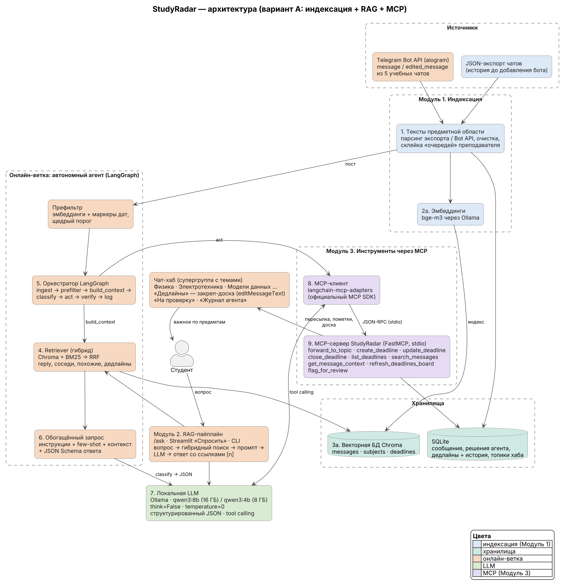
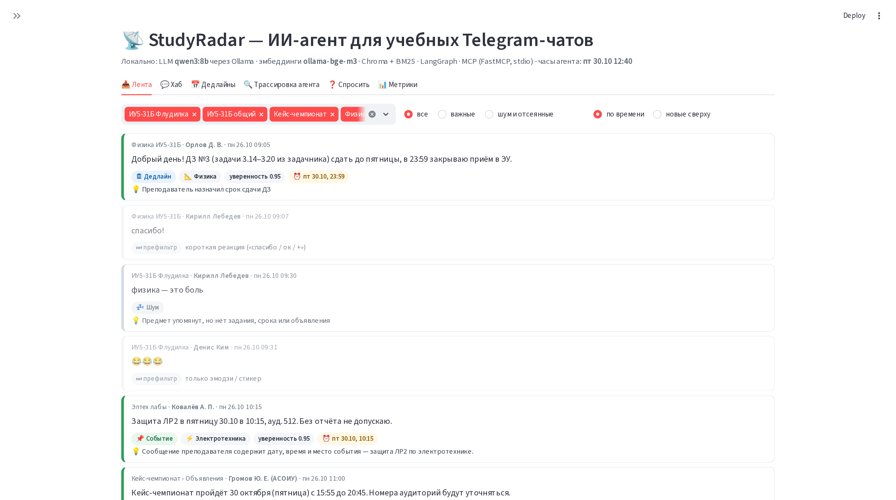
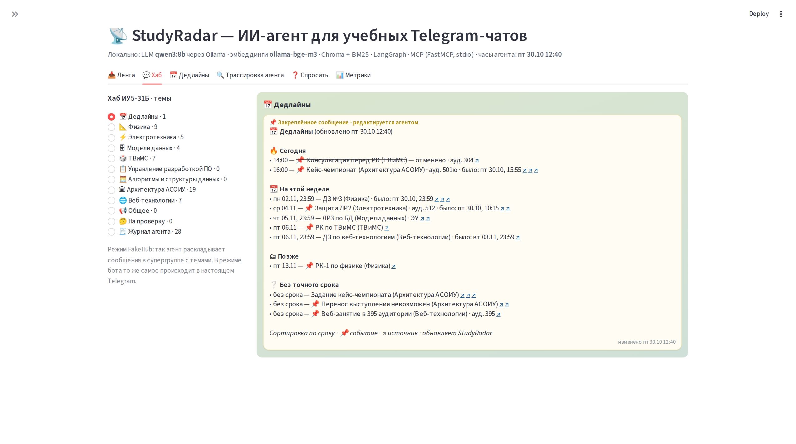
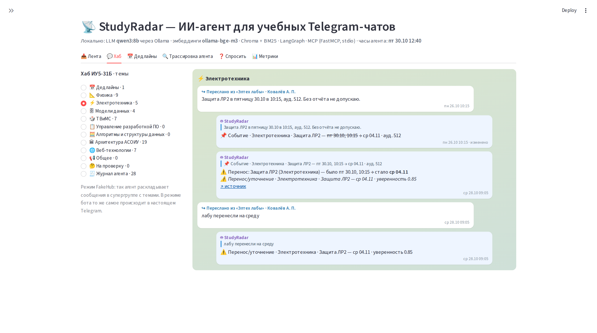
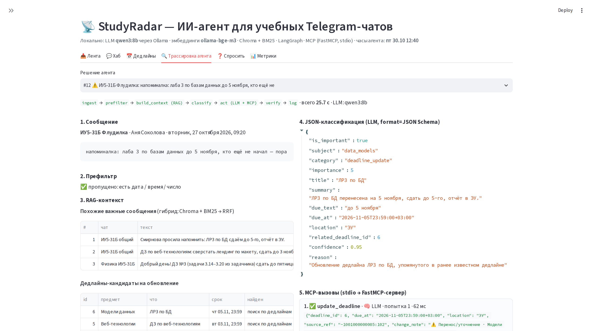
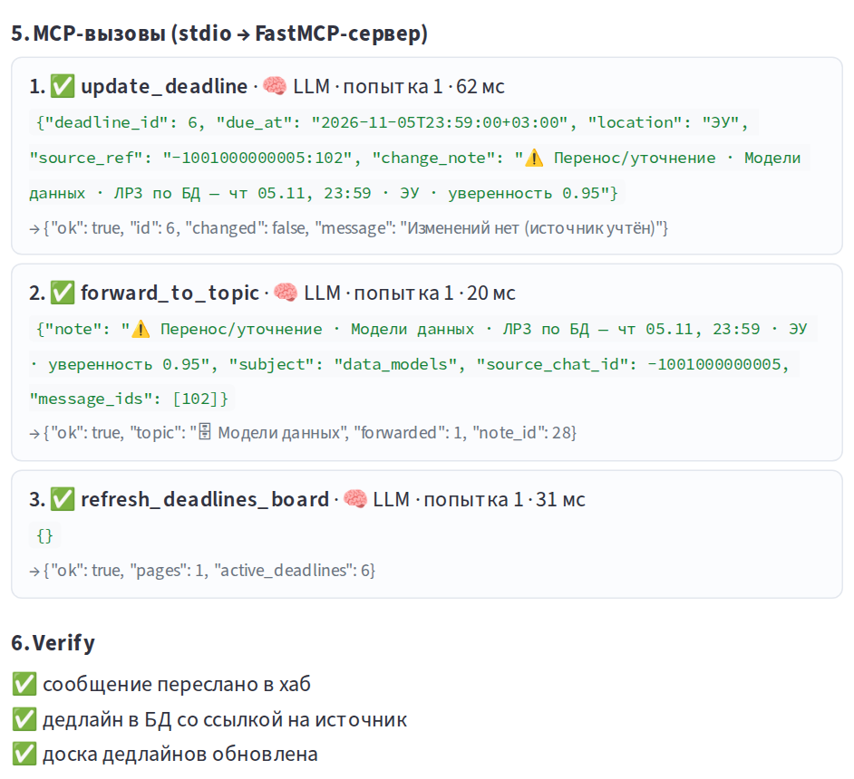
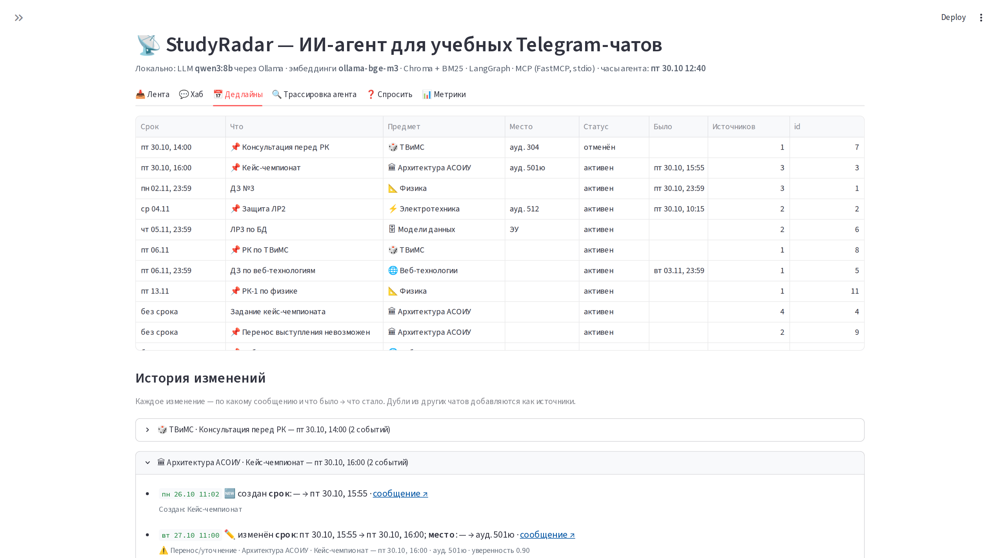
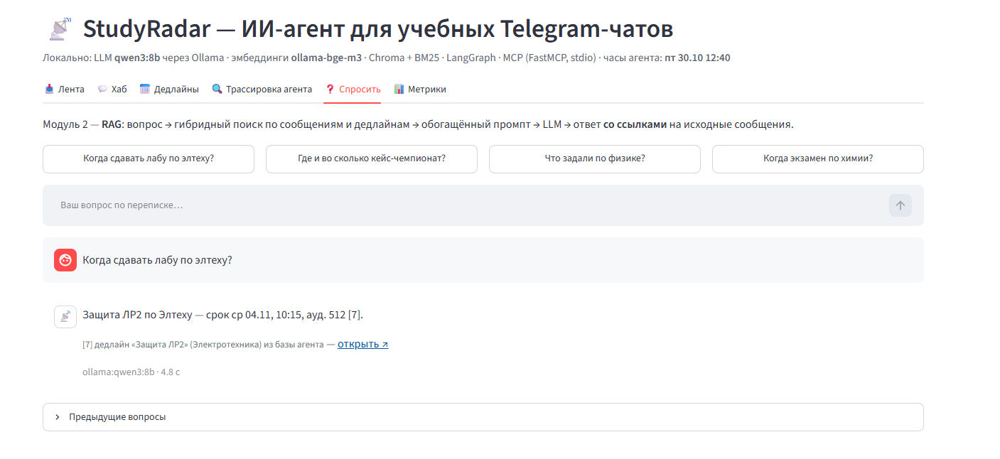

# StudyRadar — содержимое слайдов

> Файл генерируется `make slides` вместе с `docs/StudyRadar_presentation.pptx`. Состав команды — `docs/team.yaml`, скриншоты — `docs/screenshots/` (`make screenshots`), метрики — `docs/eval_report.json` (`make eval`).

> **Честность:** скриншоты и метрики модели — только с настоящей LLM (Ollama). Результаты FakeLLM (правила для тестов) в презентацию не попадают: скрипты отказываются их использовать.

## 1. Титульный слайд

**StudyRadar — ИИ-агент для сортировки учебных сообщений и контроля дедлайнов**

Команда SuperPuper · ИУ5-31Б · МГТУ им. Н. Э. Баумана, кафедра ИУ5 · кейс-чемпионат по созданию ИИ-агентов, «Архитектура АСОИУ» · 2026

## 2. Состав команды

_Все участники — группа ИУ5-31Б_

| ФИО | Группа | Роль |
|---|---|---|
| Синявский Станислав | ИУ5-31Б | Капитан; архитектура и оркестратор агента (LangGraph) |
| Теплицкий Кирилл | ИУ5-31Б | Интеграция с Telegram: бот, хаб, доска дедлайнов |
| Летуновский Артемий | ИУ5-31Б | Индексация и RAG: эмбеддинги, Chroma, гибридный поиск |
| Бабичев Александр | ИУ5-31Б | MCP-сервер и инструменты агента |
| Санина Анастасия | ИУ5-31Б | Промпты, датасет и оценка качества |
| Галюк Станислава | ИУ5-31Б | Интерфейс (Streamlit) и презентация |

## 3. Постановка задачи

_У студента 5+ учебных чатов — важное тонет во флуде_

**Проблема.** Дедлайны, задания, переносы, отмены и объявления теряются во флуде нескольких учебных чатов. Преподаватели дробят объявления на серии сообщений, сроки пишут в свободной форме, информация уточняется позже.

**Почему не ключевые слова:**

- «физика — это боль» — слово «физика» есть, но сообщение не важно (агент: шум);
- «лабу перенесли на среду» — названия предмета нет, но это перенос защиты ЛР2 по электротехнике (агент понимает по сообщению, на которое ответили, и обновляет существующий дедлайн).

## 4. Что делает агент

_Не чатбот «спроси — ответь», а автономный агент: реагирует на события сам_

1. **Читает учебные чаты** — Telegram-бот: новые и отредактированные сообщения + история из JSON-экспорта.
2. **Понимает смысл** — LLM решает: важно ли, предмет, категория, срок (от даты сообщения).
3. **Раскладывает по темам** — пересылает в тему предмета чата-хаба с пометкой агента.
4. **Ведёт доску дедлайнов** — одно закреплённое сообщение, сортировка по сроку, правится при изменениях.
5. **Отслеживает изменения** — перенос, отмена, уточнение, редактирование → обновляет, а не дублирует.
6. **Отвечает на вопросы** — /ask — ответ по переписке со ссылками на исходные сообщения (RAG).

**Агент, а не чатбот:** сам реагирует на события, принимает решения, вызывает инструменты (MCP) и исправляет ранее внесённые данные.

## 5. Архитектура

_Вариант А: индексация + RAG + инструменты через MCP_



- **Модуль 1 · Индексация** — сообщения и справочник предметов → bge-m3 → Chroma (messages, subjects, deadlines).
- **Модуль 2 · RAG-пайплайн** — вопрос → гибридный поиск (Chroma + BM25, RRF) → обогащённый промпт → LLM → ответ со ссылками.
- **Модуль 3 · Инструменты через MCP** — LLM сама вызывает 9 инструментов MCP-сервера (FastMCP, stdio): пересылка, дедлайны, доска.
- **Оркестратор LangGraph** — ingest → prefilter → build_context → classify → act → verify → log.

## 6. Три модуля варианта А в коде

_Каждый модуль легко найти по имени папки_

**Модуль 1. Индексация**

- src/study_radar/index/
- парсер Telegram-экспорта: text строкой и массивом, rich_message, темы форума, edited, файлы
- склейка «очередей» преподавателя (≤ 5 мин)
- bge-m3 через Ollama → Chroma
- идемпотентно: id = пост

**Модуль 2. RAG**

- src/study_radar/retrieval/hybrid.py
- src/study_radar/agent/ask.py
- векторный поиск + BM25 → RRF
- фильтры: предмет, чат, даты
- промпт требует ссылки [n]; нет данных — «в переписке нет информации»

**Модуль 3. MCP**

- src/study_radar/mcp_server/server.py
- src/study_radar/agent/graph.py (узел act)
- FastMCP, stdio, 9 инструментов
- клиент: langchain-mcp-adapters
- LLM сама выбирает инструменты;
- 2 неудачные попытки → фолбэк через те же MCP-инструменты

## 7. Технологии

_Всё работает локально на ноутбуке; облачные LLM не используются_

| Компонент | Выбор | Почему |
|---|---|---|
| LLM | Ollama + Qwen3 8B / 4B | локально; 16 ГБ RAM → 8B, 8 ГБ → 4B (одна строка в .env); tool calling, JSON |
| Эмбеддинги | bge-m3 (Ollama) | мультиязычная, хорошо понимает русский; тот же Ollama |
| Векторная БД | Chroma (persistent) | локально, без сервера, фильтры по метаданным |
| Retriever | Chroma + rank_bm25 → RRF | смысл + точные слова (номера ЛР, аудитории) |
| Оркестратор | LangGraph | явный граф узлов агента, условные переходы |
| MCP | FastMCP (stdio) + langchain-mcp-adapters | стандартный протокол инструментов |
| Telegram | aiogram 3 (бот) | без userbot — не рискуем личным аккаунтом |
| Хранилище | SQLite | дедлайны, история изменений, решения агента |
| Интерфейс | Streamlit + Typer CLI | дашборд для демо и трассировка агента |

## 8. Ход разработки

_Итерации: после каждой — рабочее состояние и зелёные тесты_

1. **MVP-ядро** — парсер экспорта, склейка очередей, SQLite, классификация, доска.
2. **Модули А** — Chroma, гибридный RAG, MCP-сервер, LangGraph + фолбэк.
3. **Обновления** — переносы, редактирования, дедупликация, история.
4. **Telegram** — бот на aiogram, темы хаба, закреп-доска, /ask.
5. **Интерфейс** — Streamlit: лента, хаб, дедлайны, трассировка.
6. **Оценка** — 195 размеченных постов, бейзлайн по ключевым словам.
7. **Документация** — README, схема, сценарий демо, презентация.

## 9. Трудности и решения

_Из журнала разработки (docs/devlog.md)_

| Трудность | Решение |
|---|---|
| Преподаватель дробит объявление на 5–7 сообщений | склейка «очередей» (автор, тема, ≤ 5 мин); в боте — пауза 45 с |
| Сроки словами: «до пятницы», «1,5 недели» | расчёт от даты сообщения + перепроверка кодом и dateparser |
| «05.11» читалось как время 05:11, «16:00.» — не время | отдельный разбор дат и времени, тесты на каждый случай |
| «физ» находилось внутри «физру» | проверка целого слова и списка «ложных друзей» предмета |
| 8B-модель может ошибиться в вызове инструмента (не тот, битые аргументы) | проверка плана, 2 попытки, детерминированный фолбэк через MCP |
| Telegram не умеет пересортировать сообщения | одно закреплённое сообщение-доска, editMessageText |
| Один дедлайн пишут в двух чатах | дедупликация: предмет + похожесть названия + дата + решение LLM |
| Бот не видит сообщения в группах | privacy mode → Disable в @BotFather, проверка в make doctor |
| Ноутбук без GPU: qwen3:8b на CPU слишком медленный | qwen3:4b для CPU; модели выгружаются через 5 мин; лимит RAM для WSL |

## Экранные формы

Снимаются автоматически: `make simulate` (настоящая модель) → `make screenshots`. Если нужен настоящий Telegram — см. `docs/demo_script.md` (кадры tg_*.png).

## 10. Экранная форма: лента решений

_Каждое сообщение и решение агента: категория, предмет, уверенность, причина_


Кадр: `docs/screenshots/01_feed.png` — make simulate → make screenshots: вкладка «Лента».

## 11. Экранная форма: чат-хаб и доска дедлайнов

_Закреплённая доска, отсортированная по сроку; переносы — «было: …»_


Кадр: `docs/screenshots/02_hub_board.png` — вкладка «Хаб» → тема «📅 Дедлайны».

## 12. Экранная форма: тема предмета

_Пересланное сообщение + пометка агента; при переносе старая дата зачёркнута_


Кадр: `docs/screenshots/03_hub_subject.png` — вкладка «Хаб» → «⚡ Электротехника».

## 13. Экранная форма: трассировка агента (1/2)

_Сообщение → префильтр → RAG-контекст → JSON-классификация_


Кадр: `docs/screenshots/05_trace.png` — вкладка «Трассировка агента» (перенос ЛР2).

## 14. Экранная форма: трассировка агента (2/2)

_LLM сама вызывает инструменты MCP-сервера (stdio) → verify_


Кадр: `docs/screenshots/05b_trace_mcp.png` — вкладка «Трассировка агента», раздел «MCP-вызовы».

## 15. Экранная форма: дедлайны и история

_Таблица по сроку и история изменений: было → стало, по какому сообщению_


Кадр: `docs/screenshots/04_deadlines.png` — вкладка «Дедлайны».

## 16. Экранная форма: вопрос по переписке (RAG)

_Ответ со ссылками на исходные сообщения_


Кадр: `docs/screenshots/06_ask.png` — вкладка «Спросить»: «Когда сдавать лабу по элтеху?».

## 17. Результаты

_195 размеченных постов из 5 синтетических чатов (data/eval/labeled.jsonl)_

| Метрика | StudyRadar (LLM) | Ключевые слова |
|---|---|---|
| F1 важности | 0.77 | 0.69 |
| Precision / Recall | 0.62 / 1.00 | 0.58 / 0.84 |
| Точность предмета | 0.96 | 0.47 |
| Точность категории | 0.87 | 0.71 |
| Точность даты (день) | 1.00 | 0.90 |

- Модель: ollama:qwen3:8b; железо: Linux 6.6.87.2-microsoft-standard-WSL2 · 13th Gen Intel(R) Core(TM) i7-13620H · 12 ГБ RAM · NVIDIA GeForce RTX 4060 Laptop GPU, 8188 MiB
- MCP-действия без фолбэка: 100%; корректных вызовов LLM: 94%
- Средняя задержка: 5.5 с на пост

## 18. Как запустить и где код

_Локально, на обычном ноутбуке_

```bash
ollama pull qwen3:8b && ollama pull bge-m3
make setup && make doctor
make simulate
make ui
make bot
```

**Репозиторий:** https://github.com/winlast/TG_Agent_champ

## 19. Спасибо за внимание!

Вопросы.
